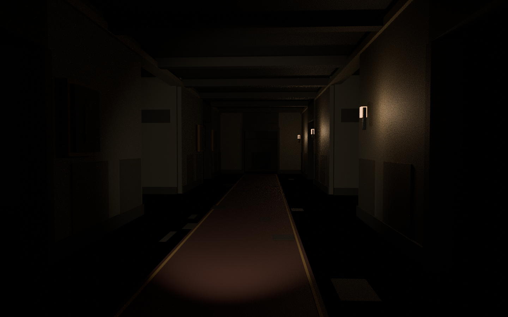

# The Last Ember — third-person co-op horror

Enter an abandoned manor with up to three friends. Find two fuses, restore the generator, burn six cursed seals, and escape while the Mourner hunts you.

## Download the new horror game

- **[Download TheLastEmber.rbxl — open this in Studio](https://github.com/naeemsan/robloxgame/raw/refs/heads/main/dist/last-ember/TheLastEmber.rbxl)**
- **[Complete game + source + audio ZIP](https://github.com/naeemsan/robloxgame/raw/refs/heads/main/dist/last-ember/TheLastEmber-Full-Package.zip)**
- [Source-only ZIP](https://github.com/naeemsan/robloxgame/raw/refs/heads/main/dist/last-ember/TheLastEmber-Source.zip)
- [Original horror sound pack — 7 WAV files](https://github.com/naeemsan/robloxgame/raw/refs/heads/main/dist/last-ember/TheLastEmber-Audio.zip)
- [Roman Urdu opening guide](dist/last-ember/START-HERE.txt)

**Open:** Roblox Studio → File → Open from File → TheLastEmber.rbxl → Play → ENTER THE HOUSE.

**Roman Urdu:** Ab purani RumalRush file nahi kholni. Nayi file dist/last-ember/TheLastEmber.rbxl hai. Yeh character ke peeche third-person camera wala horror game hai.

You can also use **Code → Download ZIP**, extract it, and find the new game under **dist/last-ember/**.

## Included

Third-person camera; original manor; Realistic lighting and flashlight shadows; 1–4 player mission; pathfinding enemy with sight/hearing; stamina; revives; short wardrobe hiding; a solo second chance; close-up jumpscares; heartbeat and positional enemy footsteps; graphical quality and scare settings.

Built-in sound fallbacks work without assigning marketplace IDs. **The supplied original WAVs require owner-side upload and experience permissions before they replace those fallbacks.** See the [audio setup guide](last-ember/docs/AUDIO-SETUP.md).

## Validation

Six scripts compile, 45 offline rules tests pass, and a clearance model reaches all mission stations, loot locations and hiding exits. Both Roblox file formats build successfully.

**Actual Roblox Studio playtesting, enemy locomotion/navmesh, co-op latency, device UI, sound playback and FPS remain unverified.** This is an atmospheric stylized build, not a claim of photorealistic graphics or guaranteed low-end performance. Read the [Studio test checklist](last-ember/docs/TESTING.md) before public release.

- [Full game documentation](last-ember/README.md)
- [Test output](last-ember/docs/AUTOMATED-TEST-OUTPUT.txt)
- [Source](last-ember/src)

### Interior layout preview

This is an offline render of the authored manor geometry, **not a Roblox Studio screenshot**. It illustrates the layout; actual engine lighting and materials differ.

### Previous prototype

The previous Rumal Rush project is preserved in [rumal-rush/](rumal-rush/) and its original dist files. It is not the current horror game.
