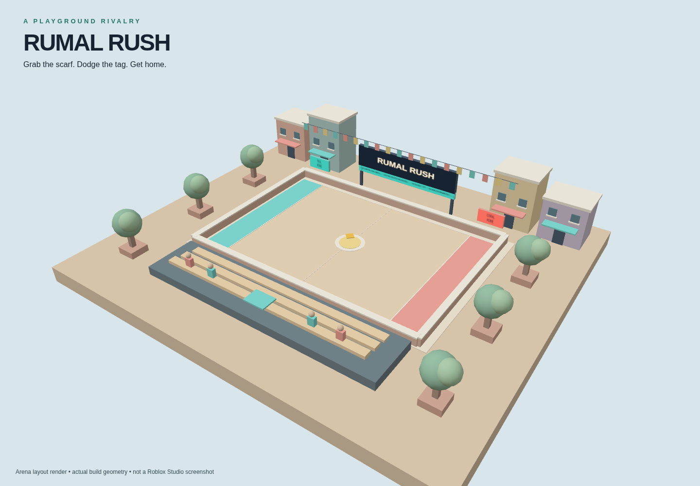

# Rumal Rush

A lightweight Roblox courtyard game inspired by Rumal Jhapatta / Steal the Bacon. Grab the scarf and reach your home line, or chase and tag the carrier. Includes a solo practice bot, multiplayer team duels, a scoreboard, coin cosmetics, and optional cosmetic game-pass support.

## Download and open — no code pasting

- **[Download the Studio game file](https://github.com/naeemsan/robloxgame/raw/refs/heads/main/dist/RumalRush.rbxl)**
- **[Download the complete game + source ZIP](https://github.com/naeemsan/robloxgame/raw/refs/heads/main/dist/RumalRush-Full-Package.zip)**
- [Source-only ZIP](https://github.com/naeemsan/robloxgame/raw/refs/heads/main/dist/RumalRush-Source.zip)
- [Roman Urdu opening guide](dist/START-HERE.txt)

Alternatively, click the green **Code** button above → **Download ZIP**. Extract the downloaded folder, then open **dist/RumalRush.rbxl** in Roblox Studio using **File → Open from File**. Press **Play**, then click **PLAY A MATCH** inside the game.

**Roman Urdu:** ZIP download karo → right-click → Extract All → Studio kholo → File → Open from File → dist folder mein RumalRush.rbxl kholo → Play dabao. Koi script paste ya plugin install nahi karna.

## What is verified

45 automated tests passed, all 7 production Luau scripts compiled, and both binary and XML Roblox place files built successfully. **Actual Roblox Studio gameplay, online saves, payment prompts, and low-end FPS still need testing.** This is a v1 build for Studio testing, not a verified public launch.

Robux purchases are disabled until the owner supplies a real game-pass ID. An unpublished local place runs in practice mode without persistent saves.

## Source and details

- [Game source and development instructions](rumal-rush/README.md)
- [Test results and remaining Studio checks](rumal-rush/docs/TESTING.md)
- [Research notes](rumal-rush/docs/RESEARCH.md)
- [Rojo project](rumal-rush/default.project.json)

